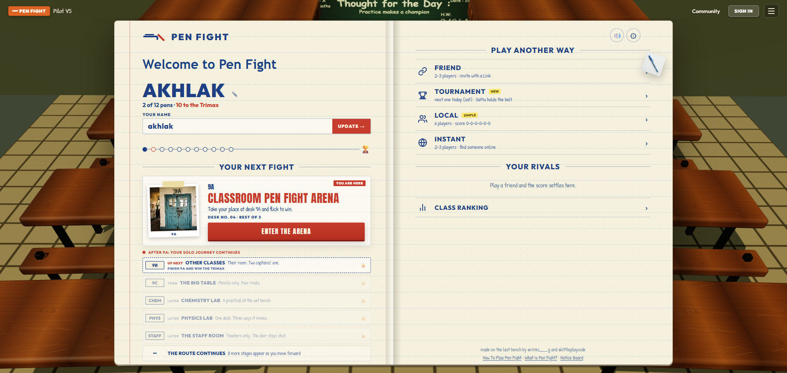
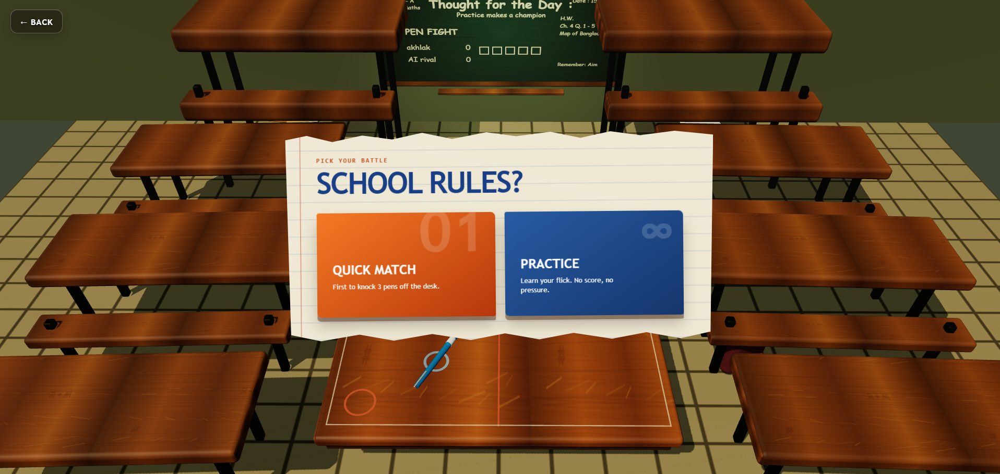
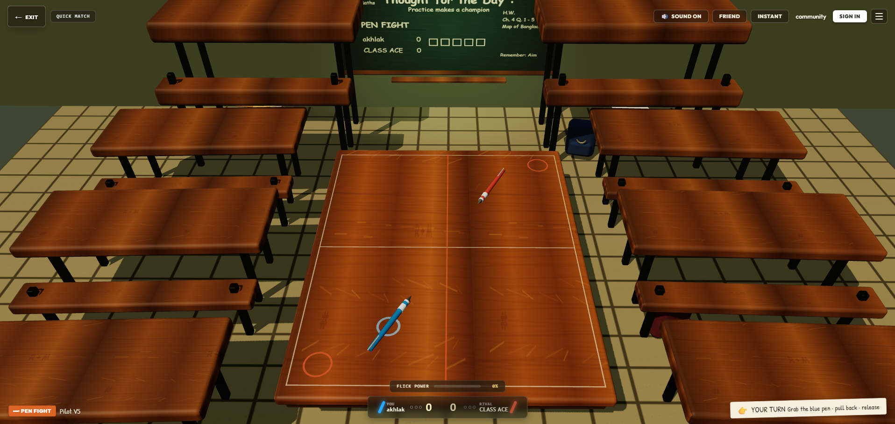

# 🖊️ Pen Fight 3D — Classroom Legends

[](https://akhlak007.github.io/pen-fight/)
[](https://vitejs.dev/)
[](https://threejs.org/)
[](https://www.typescriptlang.org/)
[](LICENSE)

> Remember those 5-minute breaks between school periods when the teacher left the room, the wooden benches were cleared, and the epic clatter of pens began? 
> **Pen Fight 3D** brings that pure childhood classroom nostalgia straight to your web browser and mobile phone!

🎮 **[Play the Live Game Now](https://akhlak007.github.io/pen-fight/)** — No downloads or installs required!

---

## 📸 Screenshots

| 🏫 Classroom Notebook Home | 🎯 Game Modes & Match Selection |
| :---: | :---: |
|  |  |

### 💥 3D Bench Arena Gameplay


---

## ✨ Features

- 🎲 **Realistic 3D Physics Simulation**: Powered by Three.js and custom momentum physics. Pens spin, collide, teeter dangerously on desk edges, and tumble off into knockouts.
- 🌐 **Online Multiplayer with Friends**: Generate an instant invite room code/link, share it on WhatsApp/Messenger, and battle friends in real-time across phone and PC.
- 📱 **Engineered for Mobile & Touchscreens**:
  - Intuitive slingshot flick gesture (pull back to charge power and aim, release to strike).
  - Dynamic camera perspective: Player 2 automatically sees the desk from their end so pulling downward naturally launches their pen forward.
  - Safe-area notch and orientation awareness across smartphones, tablets, and desktops.
- 👥 **Local Same-Device Multiplayer**: Pass-and-play matches for **2 to 4 players** on a single phone or laptop.
- 🤖 **Solo Mode vs AI**: Sharpen your flicking skills against the AI Class Ace in quick matches.
- 🔊 **Immersive Classroom Ambience**: Authentic background classroom chatter with an easily accessible mute/unmute button.
- ⚡ **Zero Friction**: 100% web-based. Runs in any modern browser on Android, iOS, Windows, Mac, and Linux.

---

## 🎯 How to Play

1. **Aim Your Pen**:
   - **Touch / Mouse**: Tap and drag back from your highlighted pen to adjust direction and shot power. An aiming trajectory guide will show your predicted line of fire.
   - **Keyboard**: Use **Arrow Keys** to steer and charge power, then press **Space** or **Enter** to strike.
2. **Launch the Strike**: Release your finger or mouse button to flick your pen into the opponent's pen.
3. **Score a Knockout**: Push your rival's pen completely off the wooden desk edge to claim the point!
4. **Win the Match**: First player to score **2 points** wins the crown and becomes the Classroom Champion! 🏆

---

## 🛠️ Tech Stack & Architecture

- **Rendering Engine**: [Three.js](https://threejs.org/) (WebGL / PBR materials, shadows, realistic lighting, and camera trauma screen-shake).
- **Frontend Core**: Vanilla TypeScript & CSS (optimized for sub-second load times and lightweight bundle footprint).
- **Build Tool**: [Vite](https://vitejs.dev/) with strict tree-shaking and modern ES modules.
- **Networking**: Dual-layer architecture:
  - High-performance local WebSocket room server for development.
  - Decentralized MQTT relay fallback (`test.mosquitto.org`) for zero-configuration, serverless peer invites.
- **Testing**: [Playwright](https://playwright.dev/) for full end-to-end multi-device browser testing & [Vitest](https://vitest.dev/) for unit testing physics and state controllers.

---

## 🚀 Running Locally

### Prerequisites
- [Node.js](https://nodejs.org/) (v18 or higher recommended)
- `npm`

### Setup

1. **Clone the repository**:
   ```bash
   git clone https://github.com/akhlak007/pen-fight.git
   cd pen-fight/game-web
   ```

2. **Install dependencies**:
   ```bash
   npm install
   ```

3. **Start the local dev server & room server**:
   ```bash
   npm run dev
   ```
   Open your browser at `http://localhost:4173/` (or the network URL displayed to test on your phone connected to the same Wi-Fi).

4. **Run Automated Tests**:
   ```bash
   # Run Vitest unit tests
   npm test

   # Run Playwright End-to-End tests
   npx playwright test
   ```

5. **Build for Production**:
   ```bash
   npm run build
   ```
   The production bundle is generated inside `dist/`.

---

## ☁️ Deploying on Render

The production-ready Node service, persistent SQLite leaderboard, WebSocket rooms, health check, and Render Blueprint are included. Follow [the Render deployment guide](game-web/RENDER_DEPLOY.md). A paid Render service with its configured persistent disk is required to preserve player accounts across deploys.

## 🤝 Contributing

Contributions, ideas, and feature suggestions are always welcome! Feel free to open an issue or submit a Pull Request.

---

## 📄 License

This project is licensed under the [MIT License](LICENSE).
